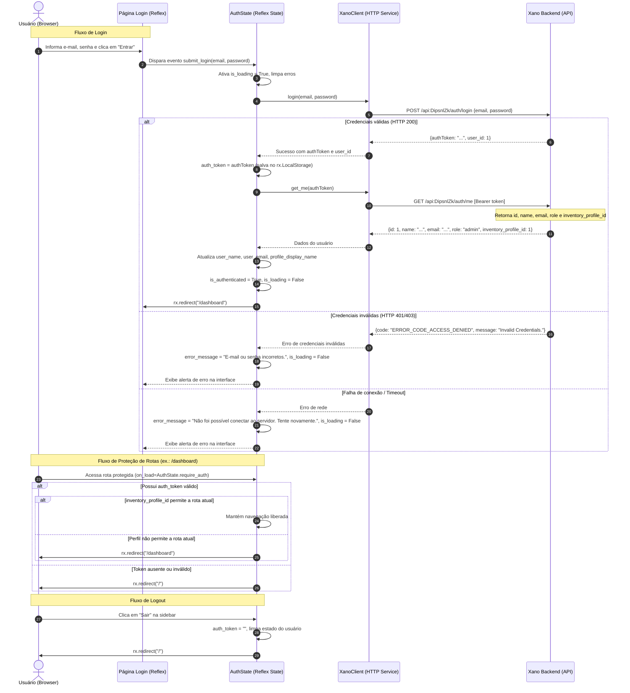

# Design: Autenticação no Frontend Reflex

## 1. Contexto e Objetivos

Este documento especifica o design técnico da integração de autenticação entre o frontend Reflex e o backend Xano.

O objetivo é substituir a tela de login estática e o usuário mock por um ciclo completo de autenticação e sessão:
1. Ajuste pontual e cirúrgico no endpoint existente `GET auth/me` do Xano para incluir `inventory_profile_id` na sua projeção de saída.
2. Autenticação segura contra a API `POST auth/login` do Xano.
3. Persistência reativa do token JWT no navegador via `rx.LocalStorage`.
4. Resolução da identidade do usuário logado via `GET auth/me`.
5. Mapeamento do perfil de domínio (`administrator`, `stockkeeper`, `read_only`) para exibição no cabeçalho do sistema.
6. Proteção das páginas internas contra acesso não autenticado, autorização de navegação por `inventory_profile_id` e suporte a logout.
7. Parametrização da URL da API do Xano via variável de ambiente.

---

## 2. Arquitetura da Solução

O fluxo geral de autenticação e gerenciamento de sessão é representado a seguir:



---

## 3. Estrutura de Arquivos e Módulos

```text
xano/
└── api/
    └── authentication/
        └── auth/
            └── me_GET.xs            # Ajuste de output para incluir inventory_profile_id

Meu_projeto/
├── services/
│   ├── __init__.py
│   └── xano_client.py       # Cliente HTTP com httpx para comunicação com Xano
├── state/
│   ├── __init__.py
│   └── auth.py              # Estado global de autenticação (AuthState) com rx.LocalStorage
├── pages/
│   ├── login.py             # Página de login conectada ao AuthState
│   ├── dashboard.py         # Configurada com on_load=AuthState.require_auth
│   └── ...                  # Demais páginas protegidas configuradas com on_load
├── components/
│   └── layout.py            # Layout atualizado com nome e perfil reais e ação de logout
└── Meu_projeto.py           # Registro de rotas e injeção do guarda de autenticação
```

---

## 4. Detalhamento dos Componentes

### 4.0 Ajuste no Backend Xano (`xano/api/authentication/auth/me_GET.xs`)

O endpoint `auth/me` é responsável por retornar os dados do registro `user` pertencente ao token (`$auth.id`).
A alteração no backend é restrita e pontual: estender o array `output` da consulta para incluir `inventory_profile_id`:

```xs
// xano/api/authentication/auth/me_GET.xs
db.get user {
  field_name = "id"
  field_value = $auth.id
  output = [
    "id"
    "created_at"
    "name"
    "email"
    "account_id"
    "role"
    "inventory_profile_id"
  ]
} as $user
```

Nenhum outro elemento do backend (tabelas, endpoints ou lógica de autorização) é modificado nesta change.

---

### 4.1 Cliente HTTP (`Meu_projeto/services/xano_client.py`)

Responsável por encapsular as chamadas de rede à API do Xano utilizando `httpx.AsyncClient`:

- **Configuração de URL Base:**
  Lê a variável de ambiente `XANO_API_BASE_URL` (exemplo: `https://x8ki-letl-twmt.n7.xano.io`).
  O grupo de autenticação possui a canonical `DipsnlZk`. A URL dos endpoints é resolvida como:
  ```python
  BASE_URL = os.getenv("XANO_API_BASE_URL", "https://x8ki-letl-twmt.n7.xano.io").rstrip("/")
  AUTH_API_GROUP = f"{BASE_URL}/api:DipsnlZk"
  ```

- **Métodos expostos:**
  1. `async def login(email: str, password: str) -> dict`:
     - Dispara `POST {AUTH_API_GROUP}/auth/login` com JSON `{"email": email, "password": password}`.
     - Retorna `{ "authToken": str, "user_id": int }` se HTTP 200.
     - Lança exceção de credencial inválida para status 401 ou 403.
     - Lança exceção de conexão para erros de transporte de rede (`httpx.RequestError`).
  2. `async def get_current_user(auth_token: str) -> dict`:
     - Dispara `GET {AUTH_API_GROUP}/auth/me` com cabeçalho `Authorization: Bearer {auth_token}`.
     - Retorna os dados do usuário (`id`, `name`, `email`, `role`, `inventory_profile_id`).
     - Lança exceção de sessão expirada se HTTP 401/403.

---

### 4.2 Estado de Autenticação (`Meu_projeto/state/auth.py`)

A classe `AuthState(rx.State)` centraliza o ciclo de vida da sessão:

- **Vars reativas:**
  - `auth_token: str = rx.LocalStorage(name="auth_token")`: token JWT armazenado e sincronizado com o navegador.
  - `user_id: int = 0`: ID do usuário autenticado.
  - `user_name: str = ""`: Nome completo do usuário autenticado.
  - `user_email: str = ""`: E-mail do usuário autenticado.
  - `inventory_profile_id: int = 0`: ID do perfil de estoque vinculado.
  - `profile_display_name: str = ""`: Nome de exibição (`Líder`, `Almoxarife`, `Auxiliar de almoxarifado`, `Sem perfil atribuído`).
  - `is_authenticated: bool = False`: Flag booleana indicando sessão ativa.
  - `is_loading: bool = False`: Indicador de requisição em andamento.
  - `error_message: str = ""`: Mensagem de feedback de erro para a interface.

- **Event Handlers principais:**
  - `async def submit_login(form_data: dict)`:
    - Extrai e-mail e senha.
    - Se campos estiverem vazios: define `error_message = "Por favor, preencha todos os campos."`.
    - Executa `xano_client.login(...)`.
    - Em sucesso: salva `auth_token`, executa `load_user_profile()` e redireciona para `/dashboard`.
    - Em falha: captura o tipo de erro e atualiza `error_message`.
  - `async def load_user_profile()`:
    - Executa `xano_client.get_current_user(self.auth_token)`.
    - Atualiza `self.user_id`, `self.user_name`, `self.user_email`, `self.inventory_profile_id`.
    - Mapeia `inventory_profile_id` para o nome de exibição:
      - `inventory_profile_id == 1` -> `"Líder"`
      - `inventory_profile_id == 2` -> `"Almoxarife"`
      - `inventory_profile_id == 3` -> `"Auxiliar de almoxarifado"`
      - Ausente ou nulo -> `"Sem perfil atribuído"`
    - Atualiza `self.is_authenticated = True`.
  - `def logout()`:
    - Define `self.auth_token = ""` (limpando o localStorage).
    - Reseta `user_id`, `user_name`, `user_email`, `inventory_profile_id`, `profile_display_name`, `is_authenticated = False`.
    - Retorna `rx.redirect("/")`.
  - `async def require_auth()`:
    - Utilizado como hook `on_load` nas páginas protegidas.
    - Se `not self.auth_token`: redireciona imediatamente para `rx.redirect("/")`.
    - Se possui `self.auth_token` mas `not self.is_authenticated`: tenta recuperar o perfil via `load_user_profile()`. Caso o token tenha expirado (erro 401), executa `logout()` automaticamente.
    - Depois de autenticar/restaurar a sessão, lê a rota solicitada por `self.router.url.path` e consulta um helper centralizado com `inventory_profile_id`.
    - `inventory_profile_id == 1` permite todas as rotas internas registradas; `2` permite Dashboard, Produtos, Categorias, Fornecedores, Estoque, Movimentações, Entradas, Saídas e Relatórios; `3` permite Dashboard, Produtos, Categorias, Fornecedores, Estoque, Histórico de Movimentações e Relatórios.
    - A rota `/produtos/novo` é permitida ao perfil `2`, que possui a permissão de criação de Produto, e negada ao perfil `3`.
    - Uma rota negada redireciona para `/dashboard`. Dashboard permanece como destino seguro para qualquer sessão autenticada, inclusive quando o perfil está ausente ou não reconhecido, evitando um ciclo de redirecionamentos.
    - Uma sessão sem token válido continua sendo redirecionada para `/`, preservando o comportamento atual.
  - `def check_already_logged_in()`:
    - Hook `on_load` na página de login `/`: se `self.auth_token` e `self.is_authenticated`, redireciona direto para `rx.redirect("/dashboard")`.

---

### 4.3 Tela de Login (`Meu_projeto/pages/login.py`)

A página de login será atualizada para:
- Conectar os campos de e-mail e senha ao evento de submissão do formulário.
- Substituir o texto `"Protótipo: autenticação totalmente mockada"` por feedback real de erro através de um banner visual condicional (`rx.cond(AuthState.error_message != "", ...)`).
- Adicionar estado de carregamento ao botão (`loading=AuthState.is_loading`).
- Vincular o hook `on_load=AuthState.check_already_logged_in`.

---

### 4.4 Layout Global (`Meu_projeto/components/layout.py`)

- **Identificação do Usuário:**
  Substituir o texto estático `"Admin • Usuário mock"` por:
  ```python
  rx.hstack(
      rx.vstack(
          rx.text(AuthState.user_name, weight="bold", size="2"),
          rx.text(AuthState.profile_display_name, color="#666", size="1"),
          align="end",
          spacing="0",
      ),
      rx.avatar(fallback=AuthState.user_initials, size="2"),
      spacing="3",
      align="center",
  )
  ```
- **Ação de Logout:**
  Substituir o link estático `rx.link("Sair", href="/")` por um botão ou link acoplado ao evento `on_click=AuthState.logout`.

---

## 5. Tratamento de Erros e Segurança

### 5.1 Distinção entre Erros

| Situação | Status HTTP | Tratamento no Frontend | Ação no Sistema |
| :--- | :--- | :--- | :--- |
| **Credencial Inválida (Login)** | 401 / 403 | Exibir `"E-mail ou senha incorretos."` | Mantém o usuário na página de login, limpa campo de senha. |
| **Sessão Expirada / Token Inválido** | 401 / 403 em `auth/me` | Limpar token e notificar `"Sessão expirada. Faça login novamente."` | Redireciona o usuário para `/`. |
| **Acesso Negado a Funcionalidade** | 403 `PERMISSION_DENIED` | Exibir alerta `"Você não tem permissão para realizar esta operação."` | Mantém a sessão do usuário ativa e bloqueia a ação específica. |
| **Erro de Servidor / Rede** | 500 / Timeout / ConnectionError | Exibir alerta `"Não foi possível conectar ao servidor. Tente novamente."` | Permite que o usuário tente novamente sem perder os dados digitados. |

### 5.2 Segurança e Conformidade

- **Nenhum segredo no código:** Segredos ou chaves privadas do Xano não são incluídos no repositório. O cliente consome apenas endpoints com autenticação baseada no usuário final.
- **Frontend como Camada de Apresentação:** A guarda de rotas com `require_auth` evita que a interface seja montada sem usuário logado. Contudo, cada chamada futura de leitura ou escrita enviará o `auth_token`, mantendo o Xano como árbitro definitivo de autorização.
- **Navegação por Perfil:** O guard central compara a rota atual com o perfil carregado em `AuthState`; essa regra melhora a navegação e não substitui a autorização do Xano.
- **Armazenamento Seguro do Token:** Utilização de `rx.LocalStorage`, isolado pelo domínio da aplicação no navegador.

---

## 6. Configuração de Ambiente

Para executar localmente ou em produção, o sistema lerá as variáveis a partir do arquivo `.env` ou variáveis do sistema operacional:

```bash
# .env.example
XANO_API_BASE_URL=https://x8ki-letl-twmt.n7.xano.io
```

No código Python, o carregamento será feito de forma resiliente:
```python
import os
from pathlib import Path

# Carrega .env se existir
env_path = Path(__file__).resolve().parent.parent / ".env"
if env_path.exists():
    try:
        from dotenv import load_dotenv
        load_dotenv(env_path)
    except ImportError:
        pass

XANO_API_BASE_URL = os.getenv("XANO_API_BASE_URL", "https://x8ki-letl-twmt.n7.xano.io")
```

## Auditoria de evidências para encerramento

Na revisão de 13/10/2026, o usuário confirmou que login e sessão já foram utilizados em testes reais do NexStock, que o controle de acesso do perfil Auxiliar foi validado na interface e que uma operação não autorizada chamada diretamente no Xano retornou `PERMISSION_DENIED`. Essas confirmações são evidência manual de uso real, mas não vieram acompanhadas de capturas, logs, rotas específicas percorridas ou resultados por cenário; este registro não amplia o que foi confirmado.

As Changes arquivadas `integracao-usuarios` e `integracao-perfis-permissoes` registram validações runtime posteriores de primeiro login, sessão de usuário inativo, restauração/autorização por grants, acesso manual recusado no backend e cenários com Líder, Almoxarife e Auxiliar. Elas comprovam esses escopos próprios e servem como evidência correlata. Não documentam, de forma individualizada, todos os critérios da matriz original de navegação desta Change.

### Relação com as tarefas de validação

| Tarefa | Evidência relacionada | Limite da evidência atual |
|---|---|---|
| 7.1 Login válido e redirecionamento para `/dashboard` | Confirmação do usuário de que login foi usado em teste real; Change arquivada `integracao-usuarios` registra teste runtime de primeiro login. | Não há registro específico do destino `/dashboard` para login comum; o fluxo de primeiro login pode encaminhar a `/alterar-senha`. Manter pendente até confirmar o destino do caso normal. |
| 7.2 Credencial inválida e permanência na tela | Nenhuma evidência específica encontrada nos artefatos consultados. | Ainda requer teste com e-mail inexistente ou senha incorreta e conferência da mensagem e rota. |
| 7.3 Rota protegida sem token | Contratos/specs descrevem o redirecionamento; não foi localizada evidência runtime específica para acesso anônimo a rota Reflex. | Requer teste direto no navegador sem sessão e confirmação do redirecionamento para `/`. |
| 7.4 F5, sessão persistida, nome e perfil | O usuário confirma uso real de sessão; Changes arquivadas registram restauração/autorização de sessão em outros cenários. | Não há evidência explícita de F5 em rota interna, token restaurado via `rx.LocalStorage` e exibição de nome/perfil no mesmo teste. |
| 7.5 Logout, limpeza do token e retorno ao login | Código e contrato implementam logout; nenhuma evidência runtime específica de clique, armazenamento limpo e redirecionamento foi localizada. | Requer conferir os três resultados no navegador. |
| 7.6 Indisponibilidade do Xano | O cliente e a interface implementam tratamento de conectividade; não foi localizada simulação runtime nem confirmação manual correspondente. | Requer simular falha de rede/backend e verificar mensagem e recuperação da interface. |
| 7.7 Revisão via `git status` e `git diff` | Esta auditoria preservou o worktree, mas não constitui revisão de conformidade de todas as alterações feitas durante a Change. | Requer uma revisão delimitada dos diffs atribuíveis a esta Change; alterações não relacionadas do worktree não devem ser incluídas nem descartadas. |
| 7.8 Líder em todas as rotas internas | Nenhuma evidência por rota encontrada. | Requer percorrer a matriz atual de rotas com sessão Líder e confirmar ausência de redirecionamentos por perfil. |
| 7.9 Almoxarife: rotas permitidas, `/produtos/novo`, bloqueios administrativos | As Changes de integração de usuários/perfis registram testes runtime gerais por perfil; a confirmação atual cobre apenas Auxiliar. | Não há evidência individualizada dos caminhos Almoxarife exigidos nesta tarefa. |
| 7.10 Auxiliar: rotas permitidas e bloqueios | Usuário confirmou validação do controle de acesso Auxiliar na interface; Change arquivada `integracao-perfis-permissoes` também registra cenários runtime com os perfis. | Não há lista de rotas percorridas nem confirmação específica dos redirecionamentos de `/produtos/novo`, `/movimentacoes/entradas` e `/movimentacoes/saidas`; evidência parcial, tarefa pendente. |
| 7.11 `/movimentacoes` e sessão sem perfil válido | A spec e o código documentam esses comportamentos, sem confirmação runtime específica. | Requer confirmar acesso do Auxiliar a `/movimentacoes` e acesso estável de usuário autenticado sem perfil ao `/dashboard`, sem ciclo. |

Até que os resultados específicos acima sejam confirmados, não se deve tratar existência de código, contratos ou testes de outras Changes como aprovação integral destas tarefas. As confirmações do usuário e as evidências correlatas ficam registradas para evitar repetir os testes já comprovados no escopo correspondente.

### Complemento: confirmações manuais das tarefas 7.1 a 7.5

Em confirmação posterior, o usuário informou que executou estes testes no NexStock:

| Tarefa | Resultado manual informado |
|---|---|
| 7.1 | Login com credenciais válidas redirecionou para `/dashboard`. |
| 7.2 | Credenciais inválidas exibiram mensagem de erro e mantiveram o usuário na tela de login. |
| 7.3 | Acesso a rota protegida sem sessão redirecionou para `/`. |
| 7.4 | Após F5, a sessão permaneceu autenticada e foi restaurada corretamente. |
| 7.5 | Logout retornou ao login e impediu novo acesso às páginas protegidas sem autenticação. |

Esses resultados são confirmações manuais do usuário; não foram fornecidos logs, capturas ou respostas HTTP, portanto não são apresentados como tais. A inspeção de `Meu_projeto/state/auth.py` confirma que `auth_token` usa `rx.LocalStorage(name="auth_token")`; `logout()` chama `_reset_user_data()`, atribui string vazia ao token persistido, limpa mensagens de erro e de troca de senha e retorna `rx.redirect("/")`. O reset limpa os dados do usuário em memória e marca a sessão como não autenticada. O `require_auth()` redireciona sessões sem token para `/`. Com a confirmação runtime do usuário e essa verificação do mecanismo implementado, os critérios das tarefas 7.1 a 7.5 estão cobertos.

A avaliação anterior da matriz permanece como fotografia histórica anterior a estas confirmações. As tarefas 7.6 a 7.11 continuam sem alteração de status nesta atualização.

### Testes automatizados simulados da tarefa 7.6

Em 13/10/2026 foram executados testes isolados em `tests/test_auth_connection_failures.py`, sem chamadas reais ao Xano:

- O cliente Xano recebeu `httpx.ReadTimeout` e `httpx.ConnectError` simulados no POST de login e converteu ambos para `XanoConnectionError`, com mensagem compreensível para tentar novamente.
- Com `auth_client.login` simulado para falhar duas vezes, `AuthState` manteve `is_authenticated=False`, token vazio e `is_loading=False`, exibindo a mensagem de conectividade. Uma terceira tentativa simulada bem-sucedida carregou o usuário, autenticou a sessão e limpou a mensagem de erro.
- A renderização da página de login foi verificada para confirmar que `AuthState.error_message` é apresentada em um alerta acessível (`role="alert"`).

São testes automatizados com mocks/fakes locais, não testes runtime do serviço Xano. O fluxo visual foi verificado pela composição renderizada do componente Reflex; não foi simulada uma indisponibilidade do Xano real no navegador. Os resultados atendem ao critério da tarefa 7.6 de testar visualmente o tratamento de indisponibilidade por simulação, sem interromper o backend real.

## Revisão do worktree para a tarefa 7.7

Em 13/10/2026 foi executado `git status --short` e foram revisados os diffs dos arquivos relacionados à autenticação: `Meu_projeto/state/auth.py`, `Meu_projeto/pages/login.py`, `Meu_projeto/components/layout.py`, `Meu_projeto/services/xano_client.py`, `Meu_projeto/Meu_projeto.py` e os XanoScripts de autenticação modificados. A página `login.py` não tinha diff em relação ao índice; sua implementação atual mantém o alerta ligado a `AuthState.error_message`. O teste automatizado não versionado `tests/test_auth_connection_failures.py` também foi revisado como artefato da tarefa 7.6.

Os diffs de `AuthState`, layout e `Meu_projeto.py` incluem navegação pela matriz dinâmica de grants e restrição administrativa de Usuários/Perfis. O cliente Xano recebeu métodos de integração para permissões, usuários, cadastros, estoque, histórico e relatórios. São extensões de Changes posteriores relacionadas ao uso compartilhado da sessão; não foram revertidas nem tratadas como falhas desta Change. Os XanoScripts `auth/me`, login, troca inicial e reset de senha incluem mudanças de perfil/grants e ciclo de vida de usuário, também pertencentes a trabalho posterior. As mudanças foram preservadas.

O estado completo inclui outras alterações locais: páginas de Categorias, Estoque, Fornecedores, Perfis, Produtos e Relatórios; XanoScripts de estoque, produtos, usuários, autorização e seed; lockfile; arquivos OpenSpec movidos para `archive`/`specs`; e artefatos ainda não rastreados. Elas não foram revisadas como parte funcional da tarefa 7.7, não foram interpretadas automaticamente como erros e permaneceram intactas.

Na inspeção dos diffs versionados e do teste novo, não foram encontrados valores com formato de JWT, token Bearer, senha, chave de API ou segredo por varredura de padrões e revisão das linhas alteradas; nenhum valor sensível foi reproduzido. Foi identificado, porém, `print("AUTH/ME DEBUG")` em `AuthState._populate_user`, que registra `user_id`, `inventory_profile_id`, `inventory_profile_code` e `permission_codes`. Não é credencial nem token, mas é metadado de identidade/autorização e pode aparecer no terminal/log do Reflex. O código não foi alterado por esta tarefa; recomenda-se avaliar a remoção ou redução desse diagnóstico em uma mudança autorizada.

A conferência de status e diff exigida pela tarefa foi realizada e registrada. A revisão não modificou arquivos de produção, XanoScript, índice Git ou outras Changes. A tarefa 7.7 pode ser considerada concluída como revisão documental, com o achado de log acima preservado para avaliação separada.

### Complemento: teste manual do perfil Líder (tarefa 7.8)

Em confirmação posterior, o usuário informou que percorreu manualmente as 13 rotas originais do NexStock usando uma conta com perfil Líder, incluindo `/usuarios` e `/perfis`, e não encontrou redirecionamentos indevidos. Esta é uma confirmação manual do usuário; não foram fornecidos logs ou capturas, portanto nenhum registro desse tipo é alegado. A cobertura informada corresponde ao critério da tarefa 7.8 de testar o acesso direto do Líder a todas as rotas internas. A tarefa 7.8 foi concluída; as tarefas 7.9 a 7.11 permanecem como estavam.

### Teste manual do perfil Almoxarife (tarefa 7.9)

O usuário confirmou manualmente que, com perfil Almoxarife, `/produtos`, `/produtos/novo`, `/estoque`, `/movimentacoes/entradas` e `/movimentacoes/saidas` permaneceram acessíveis, e que `/usuarios` e `/perfis` foram bloqueadas com redirecionamento ao Dashboard. Não foram fornecidos logs ou capturas. A confirmação cobre esses cinco acessos permitidos, o acesso explícito a `/produtos/novo` e os dois bloqueios administrativos. A tarefa 7.9, porém, pede testar as rotas permitidas da matriz completa. Não há confirmação para `/dashboard`, `/categorias`, `/fornecedores`, `/movimentacoes` e `/relatorios`; por isso, 7.9 permanece pendente até esses caminhos serem verificados manualmente. Não se afirma teste individual das rotas ausentes.

Em confirmação posterior, o usuário informou que também testou com Almoxarife `/dashboard`, `/categorias`, `/fornecedores`, `/movimentacoes` e `/relatorios`, todos acessíveis. Somadas às cinco rotas permitidas anteriormente confirmadas (`/produtos`, `/produtos/novo`, `/estoque`, `/movimentacoes/entradas` e `/movimentacoes/saidas`) e aos dois bloqueios já registrados (`/usuarios` e `/perfis`), as evidências cobrem a matriz da spec: as dez rotas permitidas do perfil Almoxarife, incluindo `/produtos/novo`, e o redirecionamento das rotas administrativas para `/dashboard`. A informação é registrada como teste manual informado pelo usuário, sem alegação de logs ou capturas. A tarefa 7.9 fica concluída.

## Revisão do modelo de autorização por grants (13/10/2026)

### Conflito documental identificado e decisão vigente

A matriz antiga deste design e a spec delta original `autenticacao-autorizacao` descreviam acesso operacional por IDs fixos de perfil. Em particular, afirmavam que Auxiliar (perfil 3) não poderia abrir `/produtos/novo`, `/movimentacoes/entradas` ou `/movimentacoes/saidas`, mesmo que recebesse os grants correspondentes. Essa regra contradiz a decisão funcional vigente: operações são configuráveis em Perfis e Permissões e o grant efetivo, não a identidade operacional do perfil, decide a autorização operacional. A regra antiga fica registrada aqui como decisão histórica supersedida; as specs foram alinhadas sem apagar as evidências anteriores de navegação dos perfis.

A separação administrativa continua válida: `/usuarios`, `/perfis` e suas APIs permanecem exclusivos a `administrator`/Líder, independentemente dos grants operacionais. O grant `administrator` é um caminho privilegiado de identidade, não uma permissão operacional configurável para os demais perfis. A autorização do Xano permanece obrigatória em cada endpoint.

### Evidência do código atual

- `Meu_projeto/state/auth.py` resolve rotas operacionais por `permission_codes`: `stock.entry` para `/movimentacoes/entradas`, `stock.exit` para `/movimentacoes/saidas`, `movement.read` para `/movimentacoes` e `report.read` para `/relatorios`, além dos grants próprios de cada área. `require_auth()` redireciona para `/dashboard` quando falta o grant e não contém uma negação operacional fixa por Auxiliar.
- A mesma guarda mantém `/usuarios` e `/perfis` restritos a `is_administrator`, e preserva os fluxos de autenticação e troca obrigatória de senha.
- `xano/function/inventory/authorize_permission.xs` resolve o perfil do usuário e verifica os vínculos persistidos em `inventory_profile_permission` para os códigos operacionais; entradas exigem `stock.entry`, saídas `stock.exit`, leitura de Histórico `movement.read`, Relatórios `report.read` e estoque `stock.read`. O código especial `administrator` valida o perfil `administrator`. A função falha fechada para usuário/perfil inválido, inativo ou com troca de senha pendente.
- `GET /movements` aceita `movement.read` ou `report.read` para uso compartilhado; `GET /movement_users` exige `movement.read`; resumo e opções de relatório exigem `report.read`. Isso é independente de a sessão possuir o grant da página irmã.
- As permissões iniciais atribuídas por seed a stockkeeper/read_only descrevem valores de bootstrap. Não são bloqueios imutáveis do backend: quando um administrador altera os grants pela funcionalidade de Perfis e Permissões, os códigos efetivos passam a controlar as rotas e operações.

O projeto informa como comportamento comprovado que Auxiliar com `stock.entry` acessa Entradas e com `stock.exit` acessa Saídas; sem `movement.read`, não acessa Histórico; sem `report.read`, não acessa Relatórios. Este registro não acrescenta logs, capturas ou respostas HTTP que não foram fornecidos.

### Inconsistências e limite encontrado

Além da regra antiga nesta Change, a spec consolidada `integracao-frontend-produtos` dizia que Auxiliar nunca recebe ações de escrita na UX sob a matriz inicial, sem distinguir a configuração posterior dos grants. A spec consolidada `consulta-backend-historico-movimentacoes` atribuía incorretamente `stock.read` a `GET /movements` e `GET /movement_users`. As specs foram corrigidas para descrever os contratos e os grants efetivos atuais. A spec consolidada `integracao-perfis-permissoes` já descrevia grants dinâmicos para o menu e APIs; foi ampliada para explicitar que o guard de rota usa a mesma fonte.

Há um possível desalinhamento no código que não foi alterado nesta revisão: `AuthState.is_administrator` considera `inventory_profile_code == "administrator"`, `inventory_profile_id == 1` **ou** `user_role == "administrator"`, enquanto `authorize_permission.xs` identifica o caminho administrativo pelo código do perfil `administrator`. Se dados de sessão legados ou inconsistentes satisfizerem apenas o ID/role, a interface pode exibir acesso administrativo que o Xano recusará. A regra mínima futura é alinhar a identificação administrativa do frontend à identidade canônica do perfil, sem remover a guarda nem enfraquecer o backend. Isso não afeta a decisão de grants operacionais e não foi validado em runtime nesta auditoria.

### Critérios revisados das tarefas 7.10 e 7.11

As tarefas permanecem pendentes. A 7.10 agora pede comprovar em runtime que Auxiliar pode acessar Entradas/Saídas quando recebe os grants respectivos e é redirecionado quando cada grant falta, preservando o bloqueio administrativo. A 7.11 pede comprovar separadamente os grants de Histórico e Relatórios, além do destino seguro `/dashboard` para sessão autenticada sem grants/perfil operacional e o redirecionamento de sessão não autenticada para `/`. Implementação e exemplos funcionais informados não substituem essas combinações de teste ainda não documentadas para cada estado.

## Cobertura adicional da tarefa 7.10 (13/10/2026)

Foram executados cinco testes automatizados isolados em `tests/test_auth_operational_route_permissions.py`, usando estado Reflex simulado e mocks locais, sem chamadas ao Xano e sem alterar grants:

- Para `/produtos/novo`, `/produtos/42/editar`, `/movimentacoes/entradas` e `/movimentacoes/saidas`, os testes confirmam que `_required_route_permission` associa respectivamente `product.create`, `product.update`, `stock.entry` e `stock.exit`, e que `AuthState.has_permission` retorna permitido com o código presente e negado sem ele. Isso cobre a condição de autorização do guard; não é teste de navegador nem execução integral de `require_auth()` com redirecionamento.
- Conceder esses quatro grants simulados a um perfil Auxiliar não o transforma em administrador. A confirmação manual previamente informada pelo usuário de bloqueio de `/usuarios` e `/perfis` permanece como evidência de runtime para a exclusividade administrativa.
- Os testes dos estados `ProductsState` com perfil Auxiliar ID 3 e grants simulados `product.create`/`product.update` confirmaram que a listagem mantém `can_manage_products=False` (flag usada para o botão Novo produto e a ação Editar) e que os loaders dos formulários retornam mensagens de perfil não autorizado. São testes simulados que detectam uma divergência da implementação atual, não aprovações do comportamento desejado.

### Matriz de cobertura e pendências

| Permissão/cenário | Evidência | Situação |
|---|---|---|
| `product.create` concedida | Predicado de rota simulado passa; loader e botão permanecem bloqueados por perfil Auxiliar ID 3. | **Falha de implementação**; não comprovado como fluxo funcional. |
| `product.create` ausente | Usuário informou que Auxiliar não acessa criação sem o grant. | Confirmação manual de bloqueio; falta complementar botão e teste direto da rota sem grant, se não incluídos no teste funcional da correção. |
| `product.update` concedida | Predicado de rota simulado passa; ação Editar/formulário permanecem bloqueados pelo perfil Auxiliar. | **Falha de implementação**; não comprovado como fluxo funcional. |
| `product.update` ausente | Não foi encontrada confirmação runtime específica de ocultação de Editar e bloqueio de URL direta para Auxiliar sem o grant. | Pendente. |
| `stock.entry` concedida | Usuário confirmou que Auxiliar acessa Entradas quando possui o grant; teste simulado confirma o mapeamento e o predicado. | Confirmado manualmente para acesso; sem evidência individual de renderização da ação nesta execução. |
| `stock.entry` ausente | Teste simulado confirma que o predicado nega sem o grant; não executa o redirect da rota em navegador. | Pendente de confirmação manual do acesso direto/redirecionamento, caso não haja evidência nas Changes correlatas. |
| `stock.exit` concedida | Usuário confirmou que Auxiliar acessa Saídas quando possui o grant; teste simulado confirma o mapeamento e o predicado. | Confirmado manualmente para acesso; sem evidência individual de renderização da ação nesta execução. |
| `stock.exit` ausente | Teste simulado confirma que o predicado nega sem o grant; não executa o redirect da rota em navegador. | Pendente de confirmação manual do acesso direto/redirecionamento, caso não haja evidência nas Changes correlatas. |
| Exclusividade de `/usuarios` e `/perfis` | O usuário confirmou que Auxiliar não acessa essas rotas; teste simulado confirma que grants operacionais não tornam Auxiliar administrador. | Confirmado para os cenários informados; falta tentativa runtime com grants operacionais concedidos para comprovar a independência completa. |

A causa bloqueadora está em `Meu_projeto/pages/produtos.py`: `load_products()` define `can_manage_products` por `profile_id in (1, 2)`; `load_create_form()` e `load_edit_form()` rejeitam qualquer perfil fora desses IDs. Os botões Novo produto e Editar também são condicionados por essa flag. Isso contradiz `AuthState.require_auth()`, que permite as rotas de criação/edição quando os grants correspondentes estão em `permission_codes`. A correção mínima futura é separar `product.create` de `product.update` no estado da tela, carregar os grants de `AuthState` e usá-los para as ações/handlers e para os gates dos formulários, mantendo o guard de rota e a autorização definitiva do Xano.

A tarefa 7.10 permanece pendente. Antes de concluí-la, a correção deverá ser feita em etapa autorizada e então verificada com Auxiliar com e sem cada grant: visibilidade de Novo/Editar, abertura das rotas concedidas, redirecionamento das rotas sem grant e manutenção dos bloqueios administrativos. Entradas/Saídas já têm confirmação manual de acesso com grant; ausência de cada grant ainda requer evidência direta de bloqueio/redirecionamento, salvo se um registro correlato individualizado for localizado. Os testes simulados acima não equivalem a esses testes runtime.

## Correção de autorização operacional de Produtos (14/10/2026)

A correção removeu os gates de `profile_id in (1, 2)` da página de Produtos. `ProductsState._session()` agora recarrega da sessão autenticada os grants `product.read`, `product.create`, `product.update` e `product.inactivate`; ativação continua vinculada a `product.update`, conforme o contrato do endpoint publicado. A listagem exige leitura; o botão Novo e o loader/evento de cadastro exigem `product.create`; Editar e os loaders/eventos de edição exigem `product.update`. Os eventos fazem a checagem de grant novamente, portanto chamar diretamente um handler sem o grant não contorna o controle visual.

A proteção de rota em `AuthState.require_auth()` foi preservada: `/produtos/novo` exige `product.create`, `/produtos/{id}/editar` exige `product.update`, e a leitura da área exige `product.read`. As rotas administrativas continuam sob a condição administrativa já existente. A autorização do Xano permanece definitiva em cada chamada; nenhum grant, endpoint, XanoScript ou dado remoto foi alterado.

Os controles de status seguem separados: uma transição de ativo para inativo requer `product.inactivate`; uma transição de inativo para ativo requer `product.update`. A troca no formulário continua apenas local até Salvar. A ação de status revalida a sessão/grants, e o salvamento também valida o grant de edição e o grant específico da transição antes de enviar qualquer atualização cadastral, evitando salvar parcialmente os campos quando a transição solicitada não está autorizada. O usuário ainda pode desfazer uma transição pendente localmente.

### Evidência automatizada simulada

Em 14/10/2026, `tests.test_auth_operational_route_permissions` passou com 14 testes usando estados Reflex simulados e mocks locais, sem chamadas ao Xano e sem alterar grants. A cobertura inclui:

- Auxiliar com e sem `product.create`, tanto no estado das ações quanto no carregamento direto do formulário e no evento de cadastro; sem grant, o cliente de escrita não é chamado.
- Auxiliar com e sem `product.update`, incluindo carregamento direto e evento de salvamento; sem grant, o formulário é bloqueado e o cliente de atualização não é chamado.
- Independência entre criação e edição, mapeamento dos grants das rotas e ausência de transformação de grants operacionais em identidade administrativa.
- Compatibilidade da autorização efetiva do administrador e de Almoxarife com grants simulados.
- Separação de `product.update` e `product.inactivate`, ativação com `product.update` e manutenção do status como alteração local até salvar.

Esses resultados são testes automatizados simulados, não confirmação runtime no navegador nem no Xano. A suíte não executou o ciclo integral do hook Reflex `require_auth()` no browser; os testes verificam o mapeamento da rota para o grant e testam os loaders/eventos quando chamados diretamente. A autorização publicada no Xano não foi exercitada nesta validação. Portanto, a tarefa 7.10 permanece pendente até a confirmação manual mínima: Auxiliar com cada grant concedido e ausente, visibilidade de Novo/Editar, acesso direto e redirecionamento; manter também a verificação administrativa de `/usuarios` e `/perfis` com grants operacionais presentes. A tarefa 7.11 não foi alterada.

### Confirmação manual adicional de Produtos na tarefa 7.10 (14/10/2026)

O usuário confirmou que, usando o perfil Auxiliar sem `product.create` e `product.update`, acessar diretamente `/produtos/novo` e `/produtos/6/editar` redirecionou para `/dashboard`. O usuário também informou que capturas anteriores mostram o botão Novo produto e o formulário quando `product.create` está concedida, a ação Editar quando `product.update` está concedida, e a ausência dos respectivos controles quando os grants faltam. Estes registros são testes manuais informados pelo usuário; não se alegam chamadas HTTP, respostas de API ou operações de escrita.

Essas confirmações complementam os testes simulados da correção e comprovam os cenários manuais de exibição e acesso direto de criação/edição. A tarefa 7.10 permanece pendente: ainda faltam os cenários sem `stock.entry` e sem `stock.exit` com bloqueio da rota, além da confirmação de que `/usuarios` e `/perfis` continuam exclusivos ao administrador mesmo quando o Auxiliar possui grants operacionais. As evidências anteriores permanecem preservadas.

### Confirmação manual de Entradas, Saídas e exclusividade administrativa (14/10/2026)

O usuário confirmou manualmente que, com o perfil Auxiliar, sem `stock.entry` o acesso à página de Entrada é bloqueado e, com `stock.entry`, consegue acessá-la e realizar Entradas. Da mesma forma, sem `stock.exit` o acesso à página de Saída é bloqueado e, com `stock.exit`, consegue acessá-la e realizar Saídas. Não foram informados logs, respostas HTTP ou detalhes de chamadas; o registro limita-se aos resultados confirmados pelo usuário.

O usuário também confirmou que `/usuarios` e `/perfis` continuam restritas ao administrador mesmo quando o Auxiliar possui grants operacionais. Somadas às confirmações manuais anteriormente registradas para `product.create` e `product.update` (ações visíveis e rotas permitidas quando concedidos; controles ocultos e redirecionamento para `/dashboard` quando ausentes), todos os critérios revisados da tarefa 7.10 estão cobertos. A tarefa 7.10 foi marcada como concluída. A tarefa 7.11 permanece pendente e não foi alterada.

## Validação da autorização de Histórico e Relatórios — tarefa 7.11 (14/10/2026)

A auditoria cruzou os critérios da tarefa com `AuthState`, `MovementHistoryState`, os contratos Xano locais, as specs consolidadas e evidências anteriores:

| Critério | Evidência e resultado | Tipo |
|---|---|---|
| `movement.read` permite `/movimentacoes`; sua ausência bloqueia a rota | O guard usa `_required_route_permission('/movimentacoes') == 'movement.read'`. Há confirmação manual anterior de acesso ao Histórico por Almoxarife e de bloqueio para Auxiliar sem `movement.read`; os novos testes verificam o mapeamento e a autorização efetiva. | Confirmação manual informada pelo usuário e teste simulado |
| `report.read` sem `movement.read` e acesso ao Histórico | A rota `/movimentacoes` continua bloqueada sem `movement.read`, inclusive quando só há `report.read`. Isso é intencional e corresponde à spec: o acesso à página Histórico é separado do contrato compartilhado do endpoint. | Spec e teste simulado; sem alegação de runtime para a combinação isolada |
| Contrato compartilhado de `GET /movements` | O XanoScript exige `movement.read` com `report.read` como grant alternativo; a spec de Relatórios registra o uso compartilhado. Assim Relatórios consulta os movimentos com `report.read` sem liberar a navegação ao Histórico. | Inspeção do contrato local e spec |
| `GET /movement_users` sem `movement.read` | O endpoint local exige somente `movement.read`. Um teste mockado injeta `XanoPermissionError` no loader `load_users`; o State mantém apenas a opção neutra e registra erro de carregamento do filtro, sem expor usuários. | Inspeção do contrato local e teste automatizado simulado |
| Histórico sem `movement.read` e sem `report.read` | O guard de rota nega `/movimentacoes` porque requer `movement.read`; o endpoint `GET /movements` também exige pelo menos um dos dois grants. As confirmações anteriores do Auxiliar sem acesso ao Histórico e a simulação da matriz sustentam o bloqueio. | Confirmação manual informada pelo usuário, inspeção e teste simulado |
| Sessão autenticada sem perfil/grants operacionais em `/dashboard` | Teste simulado usa usuário não administrador, perfil inválido/sem perfil e grants vazios: não há grant operacional nem permissão requerida para `/dashboard`. O guard valida a sessão e só redireciona quando a rota exige um grant ausente; portanto o destino seguro não cria ciclo nem concede acesso operacional. | Teste automatizado simulado e inspeção do guard; sem novo teste de navegador |
| Sessão não autenticada redireciona para `/` | Confirmação manual anterior do usuário na tarefa 7.3: rota protegida sem sessão redirecionou ao login. `require_auth()` também redireciona quando o token está ausente ou a restauração da sessão falha. | Confirmação manual informada pelo usuário e inspeção do código |
| Relatórios exige `report.read` | O guard mapeia `/relatorios` para `report.read`; o usuário já havia confirmado acesso do Almoxarife à rota e ausência de acesso para Auxiliar sem esse grant. Os novos testes verificam o mapeamento e a independência entre os grants. | Confirmação manual informada pelo usuário e teste simulado |

### Distinção intencional entre rota e endpoint compartilhado

Não há divergência de autorização a corrigir entre o guard e os contratos aprovados: `AuthState` e a spec exigem `movement.read` para abrir `/movimentacoes`; `GET /movements` aceita `movement.read` ou `report.read` porque também fornece dados à tela `/relatorios`; `GET /movement_users` continua exclusivo de `movement.read`. A spec consolidada `integracao-perfis-permissoes` e o histórico de decisão da Change de Relatórios afirmam que o uso de `report.read` em `GET /movements` não deve liberar a navegação para Histórico. O design antigo arquivado de Consulta do Histórico menciona `stock.read` para `GET /movement_users`; esse texto é histórico e diverge do XanoScript atual e da spec consolidada, ambos com `movement.read`.

### Testes simulados

Em 14/10/2026 foram executados os testes de `tests.test_auth_operational_route_permissions`, que agora incluem verificações da independência `movement.read`/`report.read`, perfil sem grants operacionais, contratos dos dois endpoints e recusa mockada de `GET /movement_users`. São testes locais com mocks e inspeção de artefatos; não chamaram Xano, não alteraram grants e não substituem teste runtime das combinações de perfil. O redirecionamento de sessão não autenticada já possui confirmação manual informada pelo usuário na evidência da tarefa 7.3.

Com a cobertura documentada, a tarefa 7.11 foi concluída. A Change fica em 37/37 tarefas. A conclusão não altera o escopo vigente: `report.read` sozinho permite o endpoint compartilhado quando usado por Relatórios, mas não concede acesso à página `/movimentacoes`.
