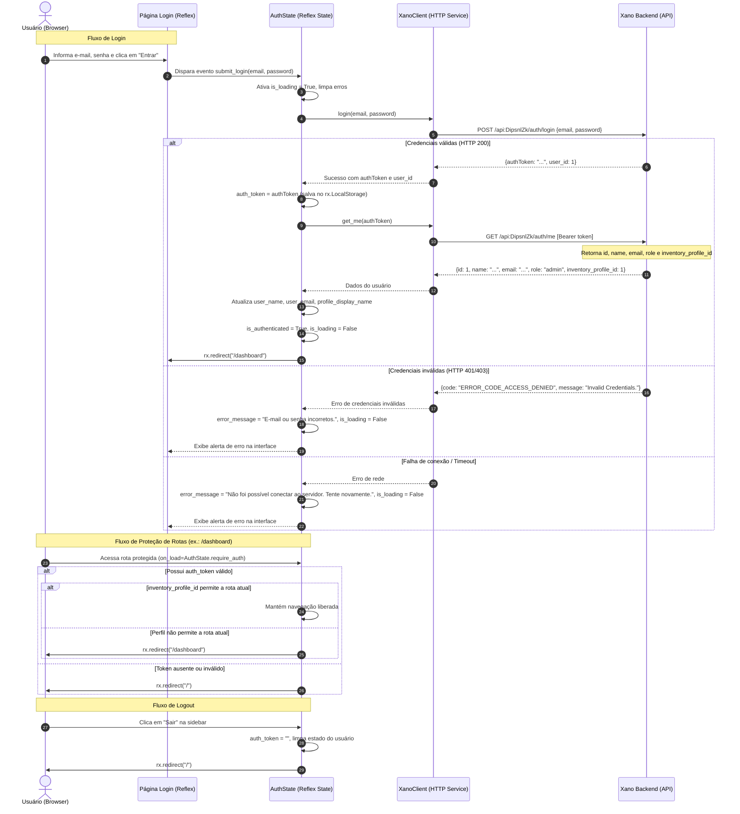

# Design: Autenticação no Frontend Reflex

## 1. Contexto e Objetivos

Este documento especifica o design técnico da integração de autenticação entre o frontend Reflex e o backend Xano.

O objetivo é substituir a tela de login estática e o usuário mock por um ciclo completo de autenticação e sessão:
1. Ajuste pontual e cirúrgico no endpoint existente `GET auth/me` do Xano para incluir `inventory_profile_id` na sua projeção de saída.
2. Autenticação segura contra a API `POST auth/login` do Xano.
3. Persistência reativa do token JWT no navegador via `rx.LocalStorage`.
4. Resolução da identidade do usuário logado via `GET auth/me`.
5. Mapeamento do perfil de domínio (`administrator`, `stockkeeper`, `read_only`) para exibição no cabeçalho do sistema.
6. Proteção das páginas internas contra acesso não autenticado, autorização de navegação por `inventory_profile_id` e suporte a logout.
7. Parametrização da URL da API do Xano via variável de ambiente.

---

## 2. Arquitetura da Solução

O fluxo geral de autenticação e gerenciamento de sessão é representado a seguir:



---

## 3. Estrutura de Arquivos e Módulos

```text
xano/
└── api/
    └── authentication/
        └── auth/
            └── me_GET.xs            # Ajuste de output para incluir inventory_profile_id

Meu_projeto/
├── services/
│   ├── __init__.py
│   └── xano_client.py       # Cliente HTTP com httpx para comunicação com Xano
├── state/
│   ├── __init__.py
│   └── auth.py              # Estado global de autenticação (AuthState) com rx.LocalStorage
├── pages/
│   ├── login.py             # Página de login conectada ao AuthState
│   ├── dashboard.py         # Configurada com on_load=AuthState.require_auth
│   └── ...                  # Demais páginas protegidas configuradas com on_load
├── components/
│   └── layout.py            # Layout atualizado com nome e perfil reais e ação de logout
└── Meu_projeto.py           # Registro de rotas e injeção do guarda de autenticação
```

---

## 4. Detalhamento dos Componentes

### 4.0 Ajuste no Backend Xano (`xano/api/authentication/auth/me_GET.xs`)

O endpoint `auth/me` é responsável por retornar os dados do registro `user` pertencente ao token (`$auth.id`).
A alteração no backend é restrita e pontual: estender o array `output` da consulta para incluir `inventory_profile_id`:

```xs
// xano/api/authentication/auth/me_GET.xs
db.get user {
  field_name = "id"
  field_value = $auth.id
  output = [
    "id"
    "created_at"
    "name"
    "email"
    "account_id"
    "role"
    "inventory_profile_id"
  ]
} as $user
```

Nenhum outro elemento do backend (tabelas, endpoints ou lógica de autorização) é modificado nesta change.

---

### 4.1 Cliente HTTP (`Meu_projeto/services/xano_client.py`)

Responsável por encapsular as chamadas de rede à API do Xano utilizando `httpx.AsyncClient`:

- **Configuração de URL Base:**
  Lê a variável de ambiente `XANO_API_BASE_URL` (exemplo: `https://x8ki-letl-twmt.n7.xano.io`).
  O grupo de autenticação possui a canonical `DipsnlZk`. A URL dos endpoints é resolvida como:
  ```python
  BASE_URL = os.getenv("XANO_API_BASE_URL", "https://x8ki-letl-twmt.n7.xano.io").rstrip("/")
  AUTH_API_GROUP = f"{BASE_URL}/api:DipsnlZk"
  ```

- **Métodos expostos:**
  1. `async def login(email: str, password: str) -> dict`:
     - Dispara `POST {AUTH_API_GROUP}/auth/login` com JSON `{"email": email, "password": password}`.
     - Retorna `{ "authToken": str, "user_id": int }` se HTTP 200.
     - Lança exceção de credencial inválida para status 401 ou 403.
     - Lança exceção de conexão para erros de transporte de rede (`httpx.RequestError`).
  2. `async def get_current_user(auth_token: str) -> dict`:
     - Dispara `GET {AUTH_API_GROUP}/auth/me` com cabeçalho `Authorization: Bearer {auth_token}`.
     - Retorna os dados do usuário (`id`, `name`, `email`, `role`, `inventory_profile_id`).
     - Lança exceção de sessão expirada se HTTP 401/403.

---

### 4.2 Estado de Autenticação (`Meu_projeto/state/auth.py`)

A classe `AuthState(rx.State)` centraliza o ciclo de vida da sessão:

- **Vars reativas:**
  - `auth_token: str = rx.LocalStorage(name="auth_token")`: token JWT armazenado e sincronizado com o navegador.
  - `user_id: int = 0`: ID do usuário autenticado.
  - `user_name: str = ""`: Nome completo do usuário autenticado.
  - `user_email: str = ""`: E-mail do usuário autenticado.
  - `inventory_profile_id: int = 0`: ID do perfil de estoque vinculado.
  - `profile_display_name: str = ""`: Nome de exibição (`Líder`, `Almoxarife`, `Auxiliar de almoxarifado`, `Sem perfil atribuído`).
  - `is_authenticated: bool = False`: Flag booleana indicando sessão ativa.
  - `is_loading: bool = False`: Indicador de requisição em andamento.
  - `error_message: str = ""`: Mensagem de feedback de erro para a interface.

- **Event Handlers principais:**
  - `async def submit_login(form_data: dict)`:
    - Extrai e-mail e senha.
    - Se campos estiverem vazios: define `error_message = "Por favor, preencha todos os campos."`.
    - Executa `xano_client.login(...)`.
    - Em sucesso: salva `auth_token`, executa `load_user_profile()` e redireciona para `/dashboard`.
    - Em falha: captura o tipo de erro e atualiza `error_message`.
  - `async def load_user_profile()`:
    - Executa `xano_client.get_current_user(self.auth_token)`.
    - Atualiza `self.user_id`, `self.user_name`, `self.user_email`, `self.inventory_profile_id`.
    - Mapeia `inventory_profile_id` para o nome de exibição:
      - `inventory_profile_id == 1` -> `"Líder"`
      - `inventory_profile_id == 2` -> `"Almoxarife"`
      - `inventory_profile_id == 3` -> `"Auxiliar de almoxarifado"`
      - Ausente ou nulo -> `"Sem perfil atribuído"`
    - Atualiza `self.is_authenticated = True`.
  - `def logout()`:
    - Define `self.auth_token = ""` (limpando o localStorage).
    - Reseta `user_id`, `user_name`, `user_email`, `inventory_profile_id`, `profile_display_name`, `is_authenticated = False`.
    - Retorna `rx.redirect("/")`.
  - `async def require_auth()`:
    - Utilizado como hook `on_load` nas páginas protegidas.
    - Se `not self.auth_token`: redireciona imediatamente para `rx.redirect("/")`.
    - Se possui `self.auth_token` mas `not self.is_authenticated`: tenta recuperar o perfil via `load_user_profile()`. Caso o token tenha expirado (erro 401), executa `logout()` automaticamente.
    - Depois de autenticar/restaurar a sessão, lê a rota solicitada por `self.router.url.path` e consulta um helper centralizado com `inventory_profile_id`.
    - `inventory_profile_id == 1` permite todas as rotas internas registradas; `2` permite Dashboard, Produtos, Categorias, Fornecedores, Estoque, Movimentações, Entradas, Saídas e Relatórios; `3` permite Dashboard, Produtos, Categorias, Fornecedores, Estoque, Histórico de Movimentações e Relatórios.
    - A rota `/produtos/novo` é permitida ao perfil `2`, que possui a permissão de criação de Produto, e negada ao perfil `3`.
    - Uma rota negada redireciona para `/dashboard`. Dashboard permanece como destino seguro para qualquer sessão autenticada, inclusive quando o perfil está ausente ou não reconhecido, evitando um ciclo de redirecionamentos.
    - Uma sessão sem token válido continua sendo redirecionada para `/`, preservando o comportamento atual.
  - `def check_already_logged_in()`:
    - Hook `on_load` na página de login `/`: se `self.auth_token` e `self.is_authenticated`, redireciona direto para `rx.redirect("/dashboard")`.

---

### 4.3 Tela de Login (`Meu_projeto/pages/login.py`)

A página de login será atualizada para:
- Conectar os campos de e-mail e senha ao evento de submissão do formulário.
- Substituir o texto `"Protótipo: autenticação totalmente mockada"` por feedback real de erro através de um banner visual condicional (`rx.cond(AuthState.error_message != "", ...)`).
- Adicionar estado de carregamento ao botão (`loading=AuthState.is_loading`).
- Vincular o hook `on_load=AuthState.check_already_logged_in`.

---

### 4.4 Layout Global (`Meu_projeto/components/layout.py`)

- **Identificação do Usuário:**
  Substituir o texto estático `"Admin • Usuário mock"` por:
  ```python
  rx.hstack(
      rx.vstack(
          rx.text(AuthState.user_name, weight="bold", size="2"),
          rx.text(AuthState.profile_display_name, color="#666", size="1"),
          align="end",
          spacing="0",
      ),
      rx.avatar(fallback=AuthState.user_initials, size="2"),
      spacing="3",
      align="center",
  )
  ```
- **Ação de Logout:**
  Substituir o link estático `rx.link("Sair", href="/")` por um botão ou link acoplado ao evento `on_click=AuthState.logout`.

---

## 5. Tratamento de Erros e Segurança

### 5.1 Distinção entre Erros

| Situação | Status HTTP | Tratamento no Frontend | Ação no Sistema |
| :--- | :--- | :--- | :--- |
| **Credencial Inválida (Login)** | 401 / 403 | Exibir `"E-mail ou senha incorretos."` | Mantém o usuário na página de login, limpa campo de senha. |
| **Sessão Expirada / Token Inválido** | 401 / 403 em `auth/me` | Limpar token e notificar `"Sessão expirada. Faça login novamente."` | Redireciona o usuário para `/`. |
| **Acesso Negado a Funcionalidade** | 403 `PERMISSION_DENIED` | Exibir alerta `"Você não tem permissão para realizar esta operação."` | Mantém a sessão do usuário ativa e bloqueia a ação específica. |
| **Erro de Servidor / Rede** | 500 / Timeout / ConnectionError | Exibir alerta `"Não foi possível conectar ao servidor. Tente novamente."` | Permite que o usuário tente novamente sem perder os dados digitados. |

### 5.2 Segurança e Conformidade

- **Nenhum segredo no código:** Segredos ou chaves privadas do Xano não são incluídos no repositório. O cliente consome apenas endpoints com autenticação baseada no usuário final.
- **Frontend como Camada de Apresentação:** A guarda de rotas com `require_auth` evita que a interface seja montada sem usuário logado. Contudo, cada chamada futura de leitura ou escrita enviará o `auth_token`, mantendo o Xano como árbitro definitivo de autorização.
- **Navegação por Perfil:** O guard central compara a rota atual com o perfil carregado em `AuthState`; essa regra melhora a navegação e não substitui a autorização do Xano.
- **Armazenamento Seguro do Token:** Utilização de `rx.LocalStorage`, isolado pelo domínio da aplicação no navegador.

---

## 6. Configuração de Ambiente

Para executar localmente ou em produção, o sistema lerá as variáveis a partir do arquivo `.env` ou variáveis do sistema operacional:

```bash
# .env.example
XANO_API_BASE_URL=https://x8ki-letl-twmt.n7.xano.io
```

No código Python, o carregamento será feito de forma resiliente:
```python
import os
from pathlib import Path

# Carrega .env se existir
env_path = Path(__file__).resolve().parent.parent / ".env"
if env_path.exists():
    try:
        from dotenv import load_dotenv
        load_dotenv(env_path)
    except ImportError:
        pass

XANO_API_BASE_URL = os.getenv("XANO_API_BASE_URL", "https://x8ki-letl-twmt.n7.xano.io")
```
